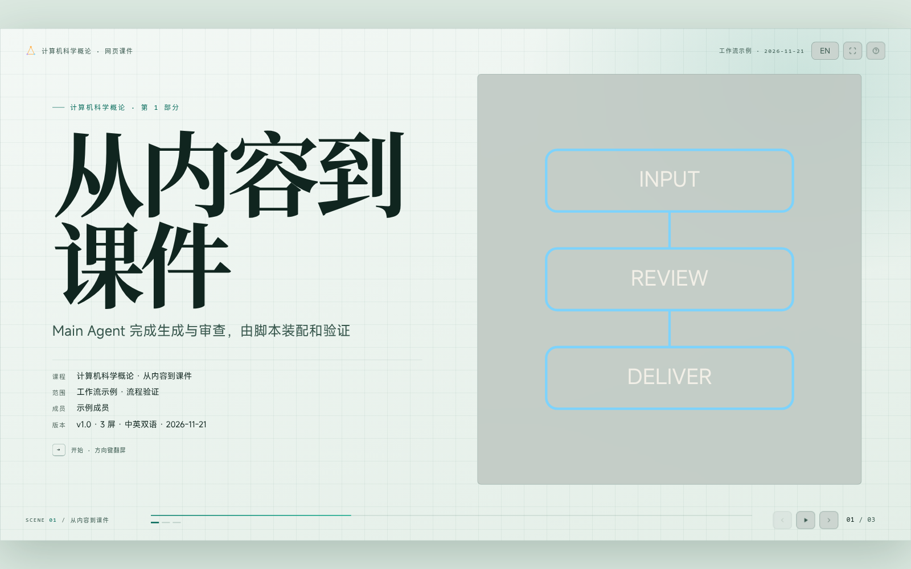
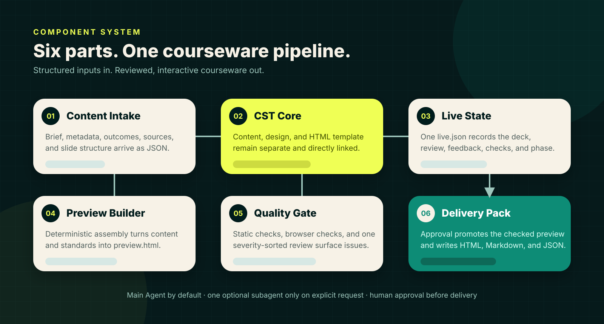
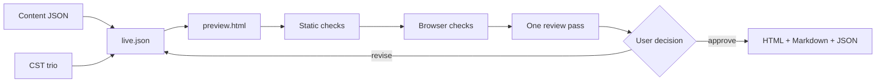
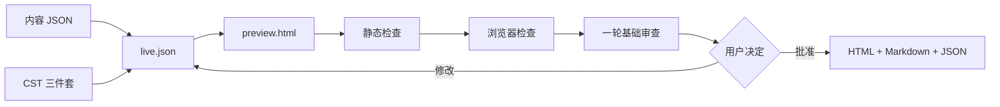

<div align="center">


# Courseware Workflow

**From structured content to polished, bilingual, interactive Lab courseware.**

[](https://github.com/Mindexo-196/lab-courseware-workflow/releases)
[](https://github.com/Mindexo-196/lab-courseware-workflow/actions/workflows/ci.yml)
[](LICENSE)
[](package.json)

[Courseware preview](#courseware-preview) ·
[Components](#component-system) ·
[Workflow](#workflow) ·
[Quick start](#quick-start) ·
[中文](#中文)

</div>

> A portable Agent Skill for producing bilingual, interactive Lab HTML
> courseware from structured content. One source can produce both a native Skill
> package and a Codex marketplace plugin.

## Courseware Preview

<p align="center">
  
</p>

<p align="center">
  <sub>Generated from the bundled example by the repository's actual build pipeline.</sub>
</p>

The bundled sample demonstrates:

- a complete cover and content hierarchy;
- bilingual labels without duplicated layout logic;
- keyboard and button navigation;
- clear progress and scene indicators;
- interactive quiz and feedback components;
- deterministic assembly from `content.json` plus the CST trio.

## At a Glance

| Layer | Input or output | Role |
| --- | --- | --- |
| **Content** | `content.json` | Brief, metadata, learning outcomes, sources, and slides |
| **State** | `live.json` | The authoritative task state across build, review, and delivery |
| **Standards** | `CST/CONTENT.md` + `CST/SKILL.md` + `CST/TEMPLATE.html` | Direct content, design, and template references |
| **Result** | `HTML` + `Markdown` + `JSON` | A reviewed and explicitly approved courseware pack |

## Component System

<p align="center">
  
</p>

| Component | Responsibility | Why it matters |
| --- | --- | --- |
| **01 · Content Intake** | Accepts structured course content and delivery requirements. | Keeps the work anchored to an explicit brief and source material. |
| **02 · CST Core** | Connects content rules, visual standards, and the HTML template directly. | Avoids silently diverging copies of the design system. |
| **03 · Live State** | Keeps one `live.json` for deck data, checks, issues, feedback, usage, and phase. | Makes recovery and validation deterministic. |
| **04 · Preview Builder** | Builds a real `preview.html` from state plus CST. | Reviews the actual interactive page instead of a description. |
| **05 · Quality Gate** | Runs static and browser checks, followed by one severity-sorted review. | Catches visual, interaction, content, and accessibility failures. |
| **06 · Delivery Pack** | Promotes only approved work into HTML, Markdown, and JSON. | Preserves the source and creates a complete, portable result. |

The context companion is a lightweight `memory.json`. It stores the current
request, compact history, page manifest, content references, and usage without
embedding HTML source.

## Workflow



```text
init → build → review → feedback / revise → build → ... → approve → deliver
```

There is no second final reviewer and no duplicate final browser pass.

## Features

- One `live.json` source of truth per courseware task.
- One lightweight `memory.json` context summary for long-running work.
- Direct CST references with project-first and bundled-runtime fallback.
- Static, browser, and single-pass review workflows.
- At least two linked components for every interactive screen.
- Main-Agent-first operation with at most one explicitly requested subagent.
- HTML, Markdown, and JSON delivery in one approved package.
- Consistent Lab color, typography, navigation, and responsive layout roles.

## Requirements

- Node.js 20 or newer.
- Chrome or Chromium for browser validation.
- `zip` and `unzip` for release archive verification.

## Quick Start

Install the native Skill and runtime into a project:

```bash
node skill/courseware-workflow/scripts/install.mjs \
  --target /path/to/project --profile codex
```

Available profiles:

```text
codex, dsh, harness, generic, claude, all
```

The installer refuses to overwrite existing workflow or Skill directories unless
`--force` is specified.

Then ask the Agent:

```text
Use $courseware-workflow to create an 18-slide bilingual Lab HTML deck about
"Linux File Systems" for first-year computer science students.
```

## Verify

Refresh the derived Skill manifest after source changes:

```bash
npm run release:manifest
```

Run the public-repository privacy scan:

```bash
npm run privacy:check
```

Run the complete temporary build verification:

```bash
npm test
```

Verification builds both archives in a temporary directory, checks structure and
SHA-256 values, installs the Skill for Codex, DSH, and Harness, then runs the
installed workflow regression suite.

## Repository Layout

```text
.
├── skill/courseware-workflow/  # canonical editable Skill
├── packaging/                  # plugin template and release notes
├── scripts/                    # release, testing, and privacy checks
├── docs/images/                # README courseware and component visuals
├── dist/README.md              # generated output location
├── .github/workflows/ci.yml    # GitHub Actions verification
├── README.md
├── LICENSE
└── CHANGELOG.md
```

The plugin's nested `skills/courseware-workflow/` directory is generated while
packaging. Do not maintain a second editable copy.

## Release

Create a versioned directory under `dist/`:

```bash
npm run release:publish
```

Generated archives are intentionally ignored by Git. Upload files from
`dist/v<version>/` as a GitHub Release rather than committing binary artifacts.

## Publish to GitHub

From a normal local checkout:

```bash
git init
git add .
git commit -m "Initial public release"
git branch -M main
git remote add origin https://github.com/OWNER/REPOSITORY.git
git push -u origin main
```

Replace `OWNER/REPOSITORY` with the destination repository. The committed tree
contains source and documentation only.

## Compatibility

| Host | Integration |
| --- | --- |
| **Codex** | Native Skill or marketplace plugin |
| **DSH** | Native Skill discovery under `.agents/skills/` |
| **DeepSeek Harness** | Project-level `.agents/skills/` workflow |
| **Claude-style hosts** | Project instructions in `profiles/claude/` |
| **Generic Markdown Agents** | Main, generator, and reviewer profiles |

## Privacy and Security

The repository contains no telemetry, personal account data, conversation
transcripts, local absolute paths, or bundled credentials.

- Imported HTML is treated as untrusted.
- Existing source HTML remains read-only.
- Browser checks bind to loopback only.
- Task state and generated courseware are excluded from Git.
- Secrets and accidental personal identifiers are checked before release.

Read [PRIVACY.md](PRIVACY.md), [SECURITY.md](SECURITY.md), and
[THIRD_PARTY_NOTICES.md](THIRD_PARTY_NOTICES.md) for details.

## Contributing

Read [CONTRIBUTING.md](CONTRIBUTING.md) before opening a pull request.

## License

MIT License, Copyright (c) 2026 Courseware Workflow Contributors.

Third-party content and generated-courseware assets remain subject to their own
licenses.

---

<a id="中文"></a>

<div align="center">

# 课件工作流

**从结构化内容，到双语、可交互、可直接交付的 Lab HTML 课件。**

[课件预览](#中文课件预览) ·
[组件介绍](#组件系统) ·
[工作流程](#工作流程) ·
[快速开始](#快速开始) ·
[English](#courseware-workflow)

</div>

> 一个用于制作双语、可交互 Lab HTML 课件的可移植 Agent Skill。同一份源码可生成
> 原生 Skill 包和 Codex marketplace 插件。

## 中文课件预览

<p align="center">
  
</p>

<p align="center">
  <sub>由仓库内置示例通过真实构建流程生成。</sub>
</p>

示例课件展示了：

- 完整封面、内容层级和视觉节奏；
- 中英文标签共用一套响应式布局；
- 键盘与按钮翻页；
- 屏幕序号、标题和进度反馈；
- 答题、正误反馈和解析联动的交互组件；
- 从 `content.json` 与 CST 三件套确定性装配 HTML。

## 一页概览

| 层级 | 输入或输出 | 作用 |
| --- | --- | --- |
| **内容** | `content.json` | 保存任务要求、元数据、学习目标、来源与逐屏内容 |
| **状态** | `live.json` | 在构建、审查和交付过程中保存唯一权威状态 |
| **标准** | `CST/CONTENT.md` + `CST/SKILL.md` + `CST/TEMPLATE.html` | 直接关联内容规范、设计规范与 HTML 模板 |
| **结果** | `HTML` + `Markdown` + `JSON` | 经审查和明确批准后形成的课件交付包 |

## 组件系统

<p align="center">
  
</p>

| 组件 | 职责 | 价值 |
| --- | --- | --- |
| **01 · 内容输入** | 接收结构化课件内容与交付要求。 | 让工作始终围绕明确需求和来源。 |
| **02 · CST 核心** | 直接关联内容规则、视觉标准与 HTML 模板。 | 避免设计标准出现多份不一致副本。 |
| **03 · 唯一状态** | 用一份 `live.json` 保存课件、检查、问题、反馈、用量和阶段。 | 使恢复和验证具有确定性。 |
| **04 · 预览构建** | 从状态与 CST 生成真实 `preview.html`。 | 审查实际页面，而不是文字描述。 |
| **05 · 质量门禁** | 执行静态检查、浏览器检查和一次分级审查。 | 发现布局、交互、内容与无障碍问题。 |
| **06 · 交付包** | 只提升已批准版本，生成 HTML、Markdown 和 JSON。 | 保留原始文件并输出完整可移植结果。 |

`memory.json` 是轻量上下文伴侣，保存当前要求、压缩历史、页面清单、内容引用和用量，
但不会嵌入 HTML 源码。

## 工作流程



```text
init → build → review → feedback / revise → build → ... → approve → deliver
```

不设置第二次最终审查，也不在交付阶段重复浏览器检查。

## 核心特性

- 每个课件任务只使用一份 `live.json` 作为状态源。
- 使用轻量 `memory.json` 为长时间任务保存上下文。
- 直接引用 CST；优先读取项目版本，缺失时回退到包内三件套。
- 包含静态检查、浏览器检查和单轮审查工作流。
- 每个交互屏至少包含两个联动组件。
- 默认由 Main Agent 完成，仅在明确要求时使用一个子 Agent。
- 经批准后以 HTML、Markdown 和 JSON 三件套交付。
- 统一 Lab 配色、字体、导航和响应式布局角色。

## 环境要求

- Node.js 20 或更高版本。
- 浏览器验收使用 Chrome 或 Chromium。
- 发布包检查需要 `zip` 与 `unzip`。

## 快速开始

将原生 Skill 与运行时安装到目标项目：

```bash
node skill/courseware-workflow/scripts/install.mjs \
  --target /path/to/project --profile codex
```

支持的安装配置：

```text
codex, dsh, harness, generic, claude, all
```

安装器默认拒绝覆盖已有工作流或 Skill 目录；只有显式使用 `--force` 才会覆盖。

随后向 Agent 发出任务：

```text
使用 $courseware-workflow 为“Linux 文件系统”制作 18 页 Lab HTML 课件。
受众是计算机专业一年级学生，需要双语标题和至少 5 屏双组件联动。
```

## 校验

源码变化后刷新派生 manifest：

```bash
npm run release:manifest
```

运行公开仓库隐私扫描：

```bash
npm run privacy:check
```

运行完整临时构建校验：

```bash
npm test
```

校验会在临时目录构建两个压缩包，检查目录结构与 SHA-256，分别为 Codex、DSH 和
Harness 执行安装冒烟测试，并运行安装后的工作流回归测试。

## 仓库结构

```text
.
├── skill/courseware-workflow/  # 唯一可编辑 Skill 源
├── packaging/                  # 插件模板与发布说明
├── scripts/                    # 发布、测试与隐私检查
├── docs/images/                # README 课件与组件视觉
├── dist/README.md              # 生成产物目录说明
├── .github/workflows/ci.yml    # GitHub Actions 校验
├── README.md
├── LICENSE
└── CHANGELOG.md
```

插件中的 `skills/courseware-workflow/` 在打包时生成，不应维护第二份可编辑源码。

## 发布

生成版本化发布目录：

```bash
npm run release:publish
```

生成的压缩包不会提交到 Git。请将 `dist/v<version>/` 中的文件上传为 GitHub Release，
而不是提交二进制产物。

## 兼容性

| 宿主 | 接入方式 |
| --- | --- |
| **Codex** | 原生 Skill 或 marketplace 插件 |
| **DSH** | `.agents/skills/` 下的原生 Skill |
| **DeepSeek Harness** | 项目级 `.agents/skills/` 工作流 |
| **Claude 风格宿主** | `profiles/claude/` 项目说明 |
| **通用 Markdown Agent** | Main、Generator 与 Reviewer 角色说明 |

## 隐私与安全

仓库不包含遥测、个人账号数据、会话记录、本地绝对路径或内置凭据。

- 导入的 HTML 始终视为不可信内容。
- 现有源 HTML 保持只读。
- 浏览器检查只绑定回环地址。
- 任务状态和生成课件不会进入 Git。
- 发布前自动检查密钥和意外个人信息。

详情见 [PRIVACY.md](PRIVACY.md)、[SECURITY.md](SECURITY.md) 和
[THIRD_PARTY_NOTICES.md](THIRD_PARTY_NOTICES.md)。

## 参与贡献

提交 Pull Request 前请阅读 [CONTRIBUTING.md](CONTRIBUTING.md)。

## 许可证

MIT License，Copyright (c) 2026 Courseware Workflow Contributors。

第三方教学材料、图片、字体和运行时组件仍遵循各自许可证。
